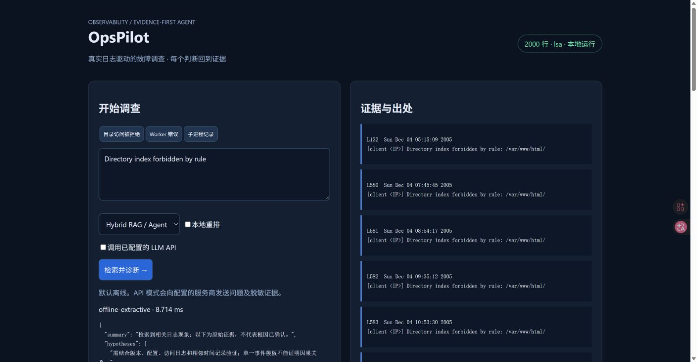

# OpsPilot

**真实 Apache 日志驱动、证据优先的故障调查 Agent。** 独立于 LLM Security Audit Gateway 的第二个项目。具备可运行网页、FastAPI、只读工具、Hybrid RAG、可选真实模型 API 与可复现的事件证据评测。



## 直接运行

当前机器已在本仓库 `.venv` 安装依赖，直接在 VS Code 打开本目录，在终端执行：

```powershell
.\.venv\Scripts\python -m opspilot.cli serve
```

访问 http://127.0.0.1:8765 。无需 API 密钥；默认使用离线向量和证据摘录。若已有服务在该端口运行，直接访问即可。

全新环境复现（Python 3.13；锁文件来自实测环境）：

```powershell
python -m venv .venv
.\.venv\Scripts\python -m pip install -r requirements.lock
.\.venv\Scripts\python -m pip install --no-build-isolation --no-deps -e .
.\.venv\Scripts\python -m opspilot.cli ingest
.\.venv\Scripts\python -m pytest -q
.\.venv\Scripts\python -m opspilot.cli evaluate
.\.venv\Scripts\python -m opspilot.cli serve
```

如果系统的 `venv` 无法自动装 pip，可用已有 pip：`python -m pip --python .venv/Scripts/python.exe install -r requirements.lock`。运行模块不依赖 editable 安装，可省略该安装步骤。Linux/macOS 将 `.venv\Scripts\python` 替换为 `.venv/bin/python`。`requirements.lock` 固定了直接与传递依赖版本，未包含跨平台 wheel 哈希；首次安装需要网络。数据已随仓库提供，之后默认运行、导入和评测不访问外网。

## 演示顺序（3 分钟）

1. 查询 `Directory index forbidden by rule`：定位 L132 等真实记录，展示 `<IP>`、官方目录索引文档及相邻日志。
2. 查询 `mod_jk child workerEnv in error state`：展示 worker 错误现象及历史版本限制，不声称 Tomcat 已宕机。
3. 切换关键词、向量与 Hybrid，比较证据排序；启用本地重排查看变化。
4. 查询 `Kubernetes pod OOMKilled memory leak`：展示证据不足与拒答。
5. 打开 `reports/offline_report.md`，解释为什么高检索分数不等于真实排障成功。

目前评测及样例以英文日志关键词为主；中文网页不代表已验证中文跨语言检索能力。

## 实现与边界

- 来源固定为 Loghub 提交 `dd61d0952749ee7963bde24220d1be5ede023033` 的 Apache 2k 样本，2000 行、6 个上游事件模板。原始行号始终保留。32 行在导入时触发脱敏。
- 原始日志独立解析为 SQLite；上游 `EventId` 只用于离线评分，不进入索引。
- 工具提供字面子串/级别/行范围查询、相邻行和级别统计；连接 `mode=ro`、`query_only=ON`、固定 SELECT、参数化输入，无任意 SQL、Shell、文件读取或修复执行能力。
- BM25：词项分词、k1=1.5、b=0.75。默认向量：字符 3–5 gram TF-IDF + 最多 64 维 TruncatedSVD，固定随机种子 42，余弦相似度。它是可离线复现的 LSA，不是预训练语义 embedding。
- Hybrid 使用 RRF（常数 60）；可选词项覆盖率 reranker，对最多 20 个候选重排。没有把它包装为神经 cross-encoder。
- 可选本地 SentenceTransformer embedding：安装 `.[neural]`，将 `OPSPILOT_EMBEDDING=sentence-transformer`、`OPSPILOT_EMBEDDING_MODEL` 设为**已下载本地模型目录**。不自动下载或执行远端模型代码；此扩展未在本次实测。
- Agent 是有界条件工作流：检索日志/文档 → 证据门槛 → 只读相邻行/统计 → 证据摘录或 LLM 生成 → 引用 ID 校验。不是能自动修复系统的自主 Agent。
- 6 条知识库阅读笔记由本项目撰写，附官方来源和版本说明，非完整官方文档镜像。链接访问状态及页面哈希见 `kb/provenance.json`。
- 只有事件现象标签，没有事故时间窗、影响范围或确认根因。默认离线回答是确定性证据摘录，**不是离线大模型**。

详见 [架构](docs/ARCHITECTURE.md)、[数据与许可](docs/DATA_CARD.md)、[运行手册](docs/RUNBOOK.md)、[评测报告](reports/offline_report.md)、[代码与面试路线](docs/LEARNING.md)。

## 接入真实 LLM API

支持 `/chat/completions` 的 OpenAI 兼容接口，需支持 JSON response_format。没有密钥时保持离线；不查找或复用本机其他项目秘密。

```powershell
$env:OPSPILOT_LLM = 'api'
$env:OPSPILOT_API_BASE = 'https://你的服务商域名/v1'
$env:OPSPILOT_API_KEY = '在自己的终端设置真实密钥'
$env:OPSPILOT_MODEL = '服务商支持的模型名'
# 可选：按服务商当前价格填写，以计算美元费用；不填则费用为 null。
$env:OPSPILOT_INPUT_USD_PER_MILLION = '填写数值'
$env:OPSPILOT_OUTPUT_USD_PER_MILLION = '填写数值'
.\.venv\Scripts\python -m opspilot.cli serve
```

重启服务后，在网页勾选调用 LLM。CLI 可使用 `python -m opspilot.cli diagnose "Directory index forbidden" --llm`。真实接口发送脱敏问题、检索日志和知识笔记，使用 40 秒超时、不跟随重定向、不自动重试。失败时保留离线证据，`provider_error` 明示失败；调用失败后 Token/费用为 null，避免伪称零成本。拒答任务不调用 API。

引用校验拒绝不存在的 ID，但不能证明每句自然语言都被证据蕴含，也不能保证模型遵从所有提示约束。所有结果需人工复核。

真实对照评测（会产生服务商费用，仅明确配置后运行）：

```powershell
$env:OPSPILOT_EVAL_LIVE = '1'
.\.venv\Scripts\python -m opspilot.cli evaluate
```

此时关键词保持离线，vector 与 hybrid 各最多 15 次 API 请求（拒答不调用）；保存 `reports/live_results.json`、`live_report.md`、`live_examples.json`，默认不纳入 Git。provider_failures 必须同时报告；未配置密钥、失败、离线回退均不能当成真实 LLM 成绩。live 报告沿用事件证据指标，不评价自然语言因果正确性。本次**没有真实付费模型调用**。

## API

- `GET /health`：样本数量与向量后端。
- `GET /logs?contains=workerEnv&level=error&start=1&end=2000&limit=20`：只读筛选。
- `GET /stats`：级别计数。
- `POST /diagnose`：`{"question":"Directory index forbidden by rule","mode":"hybrid","rerank":false,"llm":false}`。
- `GET /docs`：自动生成的交互文档。

API 默认仅绑定 loopback，没有用户认证、配额或多租户隔离。公开部署前需另行实现认证、限流、数据隔离和监控；此作品没有生产部署经历。

## Docker

```powershell
docker compose up --build -d
```

映射端口仅对本机开放。镜像中预建索引、非 root 运行；Compose 根文件系统只读并禁用额外 capabilities。构建阶段需要下载基础镜像和依赖。实际验证状态见 `reports/VALIDATION.md`，不能把 Dockerfile 的存在当成容器已验证。

## 评测可信度

比较 keyword、vector、hybrid 的 Hit@5、P@5、Recall@5、MRR、文档命中、引用有效性/相关性、任务成功、P50/P95、provider Token 与费用。固定 12 条人工正例问题 + 3 条人工负例，依据上游 EventId 及人工文档相关性表；正例覆盖六类，未做独立盲测。逐题记录及失败均保存。离线三种方法用同一摘录器，不冒充“向量+LLM”实测。见报告中的精确定义与限制。

## 许可证

自有代码 MIT，见 `LICENSE`。**MIT 不适用于 Loghub 数据。** 数据仅按上游研究/学术用途许可提供，必须保留 `data/source/LICENSE`、来源与适用引文；商业产品使用许可需另行核实。本仓库是研究和求职作品展示，不代表数据可自由商用。详见 `THIRD_PARTY_NOTICES.md`。

Docker Hub 在本机首次构建曾超时；实际构建可使用固定摘要的 Google 公共缓存，不更改 Docker 全局配置：

```powershell
docker compose build --build-arg BASE_IMAGE=mirror.gcr.io/library/python@sha256:e48f59cdba69a3cbd9ed2cf0f348d90d45a8d350d98134cf1070bc106ee9ed90
docker compose up -d --no-build
```
