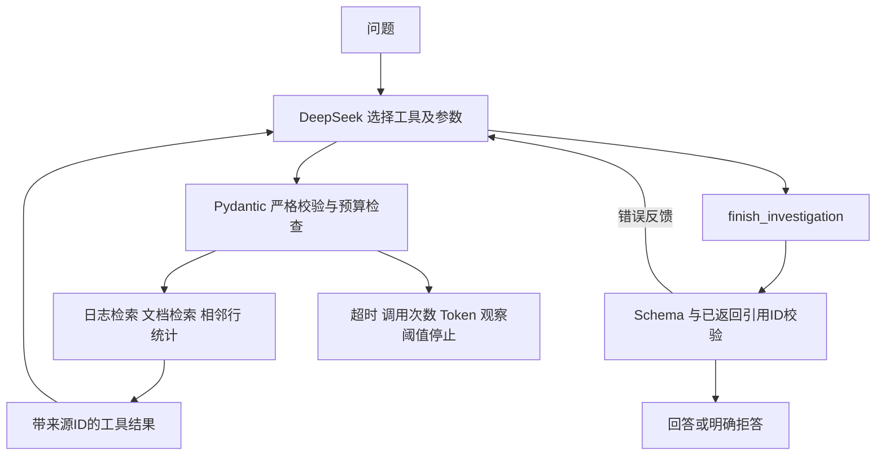
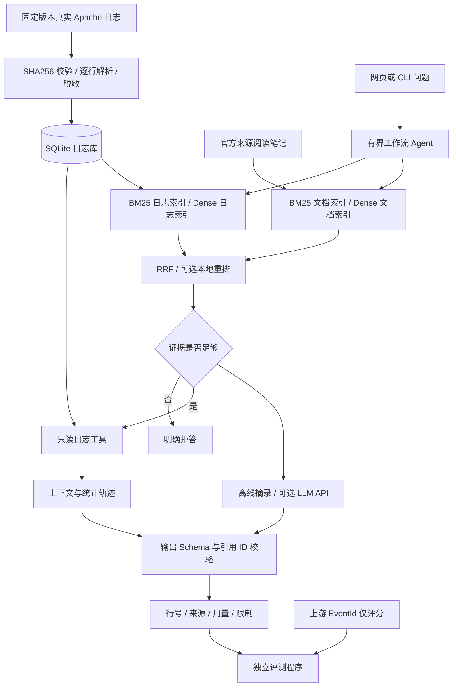

# v0.2 自主工具调用架构

模型决定工具路径；服务端执行工具。没有预先安排工具顺序。客户端保存的是决策的可观察工具调用，不保存模型私有思维链。

`tool_agent.py` 实现迭代控制、注册表、参数边界、重复调用检测、错误反馈、引用校验和用量汇总。动态模式不回退冒充离线成功。基线继续由 `agent.py` 执行固定检索并可选生成。

本机配置仅在 app.state.model_config 中存活，公开状态不含密钥；不复用其他项目配置。模型API请求只发送用户问题与本项目脱敏证据。当前部署单用户；无法防范有权限访问本机进程的恶意程序。HTTP无公网认证，仅绑定loopback。

最终引用包括 L日志、D文档和S统计。S统计通过固定参数化SQL计算并明确样本范围；相邻样本不等于完整事故时间窗。模型仍可能误解合法证据或建议不当措施，需人工复核。

以下保留 v0.1 固定流程的设计说明，作为对照背景。

# 架构与设计取舍

## 文件职责

|模块|职责|关键约束|
|---|---|---|
|ingest.py|哈希校验、正则解析、脱敏、事务导入|不导入 EventId；保留 1-based 行号|
|tools.py|查询、邻近行、统计|固定参数化 SELECT，SQLite 只读|
|retrieval.py|BM25、LSA 或本地神经向量、RRF、重排|不访问标签；确定性 tie-break|
|agent.py|检索与有界条件分支，返回工具轨迹|工具预算固定，最多相邻 5 行，无递归循环|
|llm.py|兼容 API、JSON 解析、引用验证、Token 与费用|不执行模型输出；不记录密钥或原始 provider 错误体|
|api.py|FastAPI lifespan 初始化、输入校验|本机服务，用户输入长度限制|
|evaluate.py|事件证据评分|上游标签仅在此读取|

日志和文档分别检索，避免 2000 个重复日志向量挤占仅 6 条文档的位置。日志 top-5 和文档 top-3 分开进入上下文；RRF 合并的是每个集合内部 BM25/向量排序。长度归一化与字符 ngram 让标识符可匹配，但不能提供可靠跨语言语义。

RRF 不依赖分数校准，也不等于概率。门槛使用日志 BM25 最大分数 0.5 以及至少一条文档，作为演示拒答规则；阈值不是从独立验证集校准的置信度，可能因词项重合对未知问题误接收。关键词/向量/Hybrid 使用同一门槛以保持离线对照一致。

离线与 API 回答只使用检索的日志和文档；相邻行/全局级别统计单独展示在轨迹中，不将相邻记录的同时出现解释为因果。全局统计覆盖样本，不代表完整生产系统窗口。源日志是抽样文件，行号相邻不保证原始连续时间记录。

## 安全与局限

- 没有任意命令或 SQL 工具，模型提示注入不能触发系统修复命令；但模型仍可能生成不当建议，需要人工复核。
- 用户问题与日志都会经过模式脱敏。IPv4、常见 IPv6、邮件和常见键值秘密可被替换；这不是可靠的通用 PII 检测器，罕见格式、路径、业务内容仍可能泄漏。
- 原始公开数据为可审计性保留在 source 内，不在网页/API 暴露，也不发送给模型。上传个人真实日志不是当前产品功能。
- KB 来源 URL 为固定仓库资产，网页用 textContent 呈现日志/模型输出，避免把证据作为 HTML 执行。
- API 端点由服务端环境配置。没有通过网页设置密钥或任意外部 URL 的入口。
- 接口无认证与并发配额；仅面向单用户本机演示。没有声明压力测试、SLA、生产修复率或观测数据实时接入能力。

## 后续可验证的提升

先扩展独立人工问题与真实事件窗口，再比较预训练 embedding/cross-encoder 与现有基线。收集模型 usage 和人工语义评分后才能报告真实 LLM 性能。不能用自建小样本高分替代这些工作。
